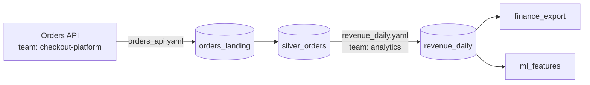

<div align="center">

# Data Contracts on Databricks

**Two data contracts between teams: checked on every pull request, enforced before data is published, and tested again after it loads.**

[Open Data Contract Standard](https://bitol-io.github.io/open-data-contract-standard/latest/) · [Data Contract CLI](https://cli.datacontract.com) · [DQX](https://github.com/databrickslabs/dqx) · Databricks Free Edition

Companion repo for the *Data Contracts on Databricks* video on the First Principles Data Engineering channel.

</div>



## Try it in two minutes (no Databricks needed)

```bash
git clone https://github.com/<you>/<your-copy>.git && cd <your-copy>
pip install -r ci/requirements.txt
python ci/check_output_schema.py
```

```text
contracts/orders_api.yaml (v1.0.0) vs pipeline/schemas.py:orders_landing
contracts/revenue_daily.yaml (v1.0.0) vs pipeline/schemas.py:revenue_daily
ok: the declared output matches both contracts
```

Now change a column in `pipeline/schemas.py` (say `amount` to `DOUBLE`) and run it again. It fails, and it says why:

```text
NOT MATCHING:
- orders_landing.amount: the contract says DECIMAL(10,2), the job writes DOUBLE
```

That is the check a pull request runs before any data exists.

## Where each check runs

| When | Where | What it checks |
|---|---|---|
| Pull request, no data and no secrets | GitHub Actions, [`contract-ci.yml`](.github/workflows/contract-ci.yml) | lint, `breaking` against the base branch, `test --dry-run`, the job's declared output against the contract, the change scenarios |
| Before publish | notebooks `01` and `02` | DQX rules built from the contract: exact columns, order and types first, then the value rules. A bad batch goes to quarantine and nothing is published |
| After the data is loaded | GitHub Actions, [`contract-data-tests.yml`](.github/workflows/contract-data-tests.yml) | `datacontract ci` on the real tables, on merge to `main`, every morning and by hand |
| What no rule covers | notebook `06_observer` | statistical drift: mean shift, distribution change, null rate, volume, freshness |

## What's inside

| Path | What it is |
|---|---|
| [`contracts/`](contracts) | the two contracts: `orders_api.yaml` and `revenue_daily.yaml` |
| [`pipeline/`](pipeline) | what each job writes, declared in code (`schemas.py`), and the silver-to-gold logic |
| [`producer/`](producer) | the simulated Orders API |
| [`notebooks/`](notebooks) | Databricks notebooks, `00_setup` to `06_observer` |
| [`scenarios/`](scenarios) | one changed contract per kind of change |
| [`ci/`](ci), [`.github/`](.github) | the pull request checks, the workflows, CODEOWNERS and the PR template |
| [`tools/`](tools) | contract generator, lineage and impact check, observer |
| [`docs/change-playbook.md`](docs/change-playbook.md) | the six kinds of change as releases |

> [!NOTE]
> The Orders API is simulated: `producer/orders_api.py` returns the JSON a `GET /orders` call would, with switches for the mistakes a producer team might ship (cents instead of dollars, an extra field, a renamed column, nulls, drift).

## Set up your copy

1. **Create your repo.** Click **Use this template** on GitHub (private is fine), then clone it.
2. **Run the pull request checks locally.** The two commands above, plus:
   ```bash
   python ci/check_scenarios.py
   ```
   *Checkpoint:* nine scenarios print, each with its `breaking` level for the consumer and the producer view.
3. **Put the repo in your workspace** (Free Edition works). Use a Git folder (Workspace, Create, Git folder; a private repo needs a GitHub credential under Settings, Linked accounts) or upload it with the Databricks CLI.
4. **Run `notebooks/00_setup`.** *Checkpoint:* the schema `vid11_databricks_contracts` has six tables, all created from `pipeline/schemas.py`.
5. **Run `notebooks/01_producer`** with `batch = good`, then `cents`, then `extra`. *Checkpoint:*

   | Batch | Result |
   |---|---|
   | `good` | 2,000 records published |
   | `cents` | rejected: 1,924 records out of range, the batch goes to `quarantine_orders` |
   | `extra`, strict | rejected: the field is not in the contract |
   | `extra`, permissive (`strict = false`) | published, the extra column is dropped |

6. **Run `02` to `06` in order:** the gold table with write, audit and publish; a contract generated from lineage; who a change would hit; the releases; the observer.

<details>
<summary><b>Turn on the after-load workflow (needs a token)</b></summary>

`contract-data-tests.yml` tests the real tables. It skips with a notice until you add three repository secrets (Settings, Secrets and variables, Actions):

| Secret | Value |
|---|---|
| `DATABRICKS_SERVER_HOSTNAME` | for example `dbc-xxxx.cloud.databricks.com` (no `https://`) |
| `DATABRICKS_HTTP_PATH` | your SQL warehouse's HTTP path |
| `DATABRICKS_TOKEN` | a personal access token, with a short expiry |

The pull request checks never need these, and pull requests from forks never get them. Delete the secrets and revoke the token when you are done.

</details>

## The six kinds of change

Each has a changed contract in [`scenarios/`](scenarios). `ci/check_scenarios.py` runs `datacontract breaking` against the current contract in both views and compares with what the playbook says. ODCS defines no minor or major rule, so the release column is our convention.

| Change | Release | Consumer view | Producer view |
|---|---|---|---|
| Add an optional column | minor | INFO | ERROR |
| Widen a type (INT to BIGINT) | minor by our rule | ERROR | ERROR |
| Drop a column: deprecate, then remove | minor, then major | INFO, then ERROR | INFO, INFO |
| Rename: add the new name, deprecate the old | minor | INFO | ERROR |
| Rename in place | major | ERROR | ERROR |
| Make a column required | major | INFO | ERROR |
| Change a meaning: add `amount_cents`, deprecate `amount` | minor | INFO | ERROR |
| Change a meaning: remove `amount` | major | ERROR | ERROR |

The reasoning is in [`docs/change-playbook.md`](docs/change-playbook.md).

## What it creates and costs

> [!WARNING]
> `00_setup` creates the schema `vid11_databricks_contracts` and its tables in the `workspace` catalog. The notebooks run as serverless jobs on your workspace. Drop the schema when you are finished, and never commit a token.

## License

[MIT](LICENSE)
